# Can One Attention Layer Help a Recurrent Model Learn Rules from Examples?

**Final report.** This report covers the experiments specified in `RESEARCH_PROPOSAL.md`. The plan and the pre-registered analysis are in `IMPLEMENTATION_PLAN.md`. A chronological record, including every deviation, is in `EXPERIMENT_LOG.md`.

Experiment 1 statistics come from `scripts/analyze_results.py` and the per-prompt predictions in `results/raw/*.csv`.
Later experiments and exploratory analyses identify their sources in the corresponding sections.

---

## Abstract

We trained small (~7M-parameter) language models from scratch on a synthetic program-execution task. In this task the meaning of made-up commands (`dax`, `wug`, …) changes from prompt to prompt, and the model must infer it from demonstrations. We compared four architectures:
- a pure 8-layer Gated DeltaNet (GDN);
- three hybrids in which exactly one GDN mixer is replaced by causal softmax attention, at layer 2, 4 or 6.

Each architecture was trained with 5 seeds. All 20 models were evaluated on 1000 identical *paired* test cases. A pair contains two prompts with the same query program but different demonstrated meanings, and counts as correct only if both answers are correct.

**Experiment 1. None of the three hypotheses was supported.**
- **H1.** On the pre-registered primary endpoint (ICL paired accuracy averaged over k = 1…8), the hybrid−pure differences were +3.5, −0.6 and −1.7 pp for early, middle and late. All Holm-corrected Welch p-values are 1.0, and all exact permutation p ≥ 0.64.
- **H2.** The three placements did not differ (ANOVA p = 0.96).
- **H3.** The hybrid advantage was no larger with demonstrations than with explicit definitions. All interactions were within ±0.4 pp, with p ≥ 0.37.

Two observations dominate the results and limit what they can say about the hypotheses:
1. **Outcome is decided by the training seed, not the architecture.** Seeds 1 and 4 "take off" to 68–90% paired accuracy in *all four* architectures. Seeds 0, 2 and 3 plateau at 21–26% in all four. This makes between-seed variance enormous (SD ≈ 31 pp), and with 5 seeds per arm only differences of roughly 60 pp would be reliably detectable.
2. **Rule inference was not the bottleneck.** In every model, ICL paired accuracy with a single demonstration already equals paired accuracy with the meaning stated explicitly (within ~1 pp), and it does not increase from k = 1 to k = 8. With the individually unambiguous demonstrations used here, the task measures *program execution*, not *rule inference*. The architectures did not differ there either.

On the more sensitive seed-paired comparison (a pre-registered secondary analysis), the early-attention hybrid scored higher than pure in 4 of 5 seeds: mean +3.5 pp, 95% CI [−1.9, +8.8], p = 0.15. This is a non-significant trend and is not evidence for H1.

An exploratory post-hoc follow-up (§10) found that the seed effect is **not** explained by the training-data order alone. With the data stream held fixed, take-off varied across initialisations. The architectures within a main seed share only the data and the initialisation of the first two GDN layers' decay and convolution parameters. A transplant experiment (§10.1) ruled out the latter as a sufficient cause: take-off is a deterministic but sensitive function of the whole initialisation, and the cross-architecture agreement remains unexplained.

**Experiment 2 (pre-registered, §11)** made inference necessary: every demonstration was consistent with two operations, so the meaning had to be inferred by combining demonstrations. Accuracy then rose with k up to k ≈ 4.
- **Pre-registered tests (seed-paired, Holm): all null again.** On the primary endpoint the hybrid − pure differences were −9.4, +8.0 and +9.6 pp for early, middle and late (Holm p = 1.0). H2: Friedman p = 0.25. H3 interactions were within ±2.5 pp, p = 1.0.
- These differences reflect which runs took off: pure 1/5, early 0/5, middle 2/5, late 2/5. Take-off was no longer shared within seeds.
- Exploratory: every run that took off, the pure GDN included, combined ambiguous demonstrations almost optimally. Accuracy on identifiable prompts equalled the definition control.

Across both experiments, a single attention layer did not measurably improve in-context rule inference. Outcomes were decided by whether the model learned to execute programs within the budget.

---

## 1. Introduction

ICL lets a model use information in its prompt, such as a new rule demonstrated by examples, without weight updates. Attention can retrieve any earlier token exactly. Recurrent models such as Gated DeltaNet (Yang et al., 2025) compress the past into a fixed-size state updated by a gated delta rule.

Prior work links ICL in transformers to attention circuits such as induction heads (Olsson et al., 2022). It also documents recall limitations of efficient recurrent models (Arora et al., 2024). Hybrid recurrent–attention models are increasingly common.

This study isolates a minimal architectural change: one attention layer in an otherwise recurrent network. It asks whether that change helps a model infer the meaning of a command from in-context demonstrations.

## 2. Research questions

- **RQ1.** Does adding one causal attention layer improve accuracy when a model must infer a command's meaning from demonstrations?
- **RQ2.** Does the depth at which the attention layer is placed matter?
- **RQ3.** Does the hybrid advantage shrink when the meaning is stated explicitly rather than inferred?

## 3. Hypotheses (from the proposal)

- **H1.** The hybrid achieves higher paired accuracy than the pure GDN, especially with few demonstrations.
- **H2.** Different attention placements produce measurably different ICL performance.
- **H3.** The hybrid advantage is larger in the demonstration task than in the direct-definition control.

## 4. Methods

### 4.1 Dataset generation (`src/data/`)

**Language.** Word-level tokens, with a vocabulary of 44.
- Assignments: `v = n`.
- Built-in updates: `set|add|sub|mul v arg`, where `arg` is a number or a variable.
- Made-up commands `cmd ∈ {dax, wug, blick, fep, zup, kiki, toma, lorp}` take the same arguments. Each prompt binds a command to one of the four built-in operations.
- All arithmetic is mod 13, so every value and answer is one token.

**Prompt structure.** Each prompt involves 3 made-up commands: one *target* and two *distractors*.
- *ICL prompt:* `<bos>`, then k demonstrations per command, interleaved, then `Q <program> <var> ->`. A demonstration is `D v = x ; cmd v n ; v -> result .`. Every demonstration is *individually unambiguous*: its result differs under each of the other three operations.
- *Definition control:* `<bos> M cmd means op .` for the same three commands, then the same query.

**Query program.** Two initialisations followed by 3 update statements. Exactly one statement uses the target command; the others are built-ins.

**Paired cases.** The two prompts of a pair share everything (program, values, query variable, distractors and their demonstrations) except the target's meaning (A ≠ B) and its demonstrations. Further constraints:
- The query variable is chosen so the two answers differ.
- Demonstrations are nested across k.
- At k = 0 the two prompts are identical text with different answers, so paired accuracy is exactly 0. This holds in all 20 models and serves as a sanity floor.

**Ground truth and splits.**
- All ground truth comes from an independent text interpreter (`interpreter.py`).
- Query-program *templates* (target position, built-in ops, data flow) are hashed into train, val and test splits: 8,376 / 1,010 / 982 of 10,368 templates.
- Training, validation and test therefore use disjoint program structures (tested in `tests/test_generator.py`).

**Training stream.**
- Example i of seed s is a deterministic function of (s, i), so all four architectures with the same seed see an *identical* data stream.
- Mix: 75% ICL prompts with k ~ U{0..8} and 25% definition prompts.
- Loss is applied to every interpreter-determined result token (demonstration results and the answer).

**Fixed evaluation sets.**
- Validation: 3,000 prompts.
- Test: 1,000 paired cases × 2 prompts × 8 conditions (k ∈ {0,1,2,3,4,6,8} plus definition) = 16,000 prompts per model.
- SHA-256 hashes are in `data/data_manifest.json`.

### 4.2 Model architectures (`src/models/`)

All models share the following:
- d_model 256, 8 pre-norm residual blocks (RMSNorm), SwiGLU MLP (hidden 704);
- untied embedding and output head;
- 4 heads × 64 dimensions in every mixer.

| model | mixers (layers 0–7) | parameters |
|---|---|---|
| `pure` | 8 × `fla.layers.GatedDeltaNet` (v0.6.0; chunk kernel, expand_v 1, short conv 4, output gate) | 7,015,232 |
| `hybrid_early` | GDN, except layer **2** = causal multi-head softmax attention (RoPE, SDPA) | 6,944,504 |
| `hybrid_middle` | attention at layer **4** | 6,944,504 |
| `hybrid_late` | attention at layer **6** | 6,944,504 |

The hybrids have 1.0% fewer parameters than pure, because an attention mixer is slightly smaller than a GDN mixer. This difference works against H1 and was not compensated.

Tests (`tests/test_models.py`) verify the following:
- pure contains no attention layer;
- each hybrid contains exactly one, at the configured index;
- attention and full models are causal;
- outputs are invariant to right-padding.

### 4.3 Training configuration (`configs/base.yaml`)

- **Optimiser:** AdamW with lr 1e-3, betas (0.9, 0.95), weight decay 0.1 on matrices, gradient clipping 1.0.
- **Schedule:** 1,000 warmup steps, then cosine decay to 10%.
- **Batch and length:** batch 128, **20,000 steps** (2.56M prompts, ~375M tokens).
- **Precision:** bf16 autocast.
- **Hardware:** NVIDIA L40S. At most 2 GPUs were used at once, with 3–4 runs stacked per GPU. A run took about 2.4 h.
- **Seeds:** 0–4 per architecture. A seed fixes both the initialisation and the data stream.

### 4.4 Experimental design and analysis (pre-registered, `IMPLEMENTATION_PLAN.md` §6)

The design is 4 architectures × 5 seeds = 20 runs, each evaluated on the final checkpoint. Predictions are the argmax over the full vocabulary; 100% of outputs were valid number tokens. The **statistical unit is the training seed.**

- **Primary endpoint:** ICL paired accuracy averaged over k ∈ {1,2,3,4,6,8}.
- **H1:** each hybrid vs pure using the following tests:
  - Welch t-test (5 vs 5), Holm-corrected over the 3 hybrids;
  - exact permutation test (252 relabelings);
  - Cohen's d;
  - a hierarchical bootstrap that resamples seeds, then shared test cases;
  - a seed-paired t-test (secondary).
- **H2:** ANOVA and Kruskal–Wallis across placements, plus pairwise Holm-corrected Welch tests.
- **H3:** the per-seed difference d = ICL primary − definition paired accuracy, compared hybrid vs pure.

### 4.5 Calibration and deviations from the original plan (details in `EXPERIMENT_LOG.md`)

1. **The original task was too hard.** It had 3 initialisations + 4 updates. In the pilot both architectures sat at about 21% validation accuracy after 4k steps. Before any main run, query complexity was made configurable, and data flow was added to the template definition.
2. **Two calibration rounds were run with the pure model only, on validation data only.** Each used a selection rule written down before it started.
   - Round 1 (6k steps) met nothing.
   - Round 2 tested {2×2, 2×3} × lr {1e-3, 2e-3} at 20k steps. The ≥70% definition-accuracy target was not reached (best 55%). By the pre-stated fallback, the configuration with the highest definition accuracy was chosen: **2 inits + 3 updates, lr 1e-3, 20k steps**.
   - The models were still improving at 20k steps. The budget was kept for compute reasons, and we note this as a limitation.
3. **The test set was not used before the main runs.** Pilots and calibration ran without test evaluation, and the fixed test set was regenerated once with the final configuration.
4. **Two figures were added after seeing the results:** fig. 8 (per-seed curves) and fig. 9. The exploratory follow-up experiment in §10 was also added after seeing the results. Both are labelled as post hoc. No pre-registered analysis was changed.

---

## 5. Main results

### 5.1 Endpoints (mean [95% t-CI across 5 seeds], %)

| arch | ICL paired, k=1–8 (primary) | ICL paired, k=1–2 | ICL individual, k=1–8 | definition paired | ICL − definition |
|---|---|---|---|---|---|
| pure | 44.6 [5.6, 83.6] | 44.6 [5.5, 83.6] | 63.3 [36.9, 89.6] | 44.7 [5.5, 83.8] | −0.0 [−0.9, 0.8] |
| hybrid_early | 48.1 [8.5, 87.8] | 48.0 [8.2, 87.7] | 65.9 [39.5, 92.3] | 48.3 [8.6, 88.0] | −0.2 [−0.7, 0.3] |
| hybrid_middle | 44.0 [6.2, 81.8] | 43.8 [5.9, 81.7] | 62.1 [36.2, 88.1] | 43.8 [5.7, 81.8] | 0.2 [−0.3, 0.8] |
| hybrid_late | 43.0 [5.7, 80.3] | 42.9 [5.7, 80.1] | 60.9 [34.8, 87.1] | 42.6 [4.9, 80.3] | 0.4 [−0.4, 1.1] |

**Per-seed primary endpoint (ICL paired accuracy, %):**

| seed | pure | hybrid_early | hybrid_middle | hybrid_late |
|---|---|---|---|---|
| 0 | 21.8 | 26.2 | 23.3 | 21.7 |
| 1 | 80.4 | 89.9 | 70.4 | 68.3 |
| 2 | 22.0 | 23.4 | 21.2 | 20.6 |
| 3 | 21.3 | 25.6 | 21.6 | 21.7 |
| 4 | 77.6 | 75.4 | 83.5 | 82.5 |

### 5.2 Accuracy by number of demonstrations (paired accuracy, %, mean ± SD across seeds)

| arch | k=0 | k=1 | k=2 | k=3 | k=4 | k=6 | k=8 | definition |
|---|---|---|---|---|---|---|---|---|
| pure | 0.0 ± 0.0 | 44.8 ± 31.2 | 44.4 ± 31.6 | 44.7 ± 31.3 | 44.7 ± 31.4 | 44.6 ± 31.5 | 44.7 ± 31.5 | 44.7 ± 31.5 |
| hybrid_early | 0.0 ± 0.0 | 47.7 ± 32.1 | 48.2 ± 32.0 | 48.1 ± 31.9 | 48.2 ± 31.9 | 48.3 ± 31.8 | 48.1 ± 31.9 | 48.3 ± 32.0 |
| hybrid_middle | 0.0 ± 0.0 | 43.6 ± 30.6 | 44.0 ± 30.5 | 44.4 ± 30.3 | 44.2 ± 30.4 | 44.1 ± 30.4 | 43.8 ± 30.6 | 43.8 ± 30.6 |
| hybrid_late | 0.0 ± 0.0 | 42.9 ± 29.9 | 42.8 ± 30.0 | 42.8 ± 30.2 | 43.2 ± 29.9 | 43.1 ± 30.0 | 42.9 ± 30.2 | 42.6 ± 30.4 |

Individual accuracy at k = 0 is 25.6–27.3%. Without demonstrations the model must guess the target's meaning, so this is roughly what a guess among four operations combined with partial execution success would give. From k = 1 on, accuracy is flat and equal to the definition condition.

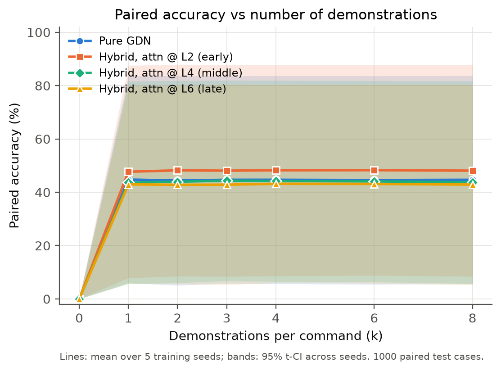

*Figure 1. Paired accuracy vs demonstrations per command. Lines show means over 5 seeds; bands show 95% t-CIs. The bands are very wide because the seed outcomes are bimodal (fig. 8).*

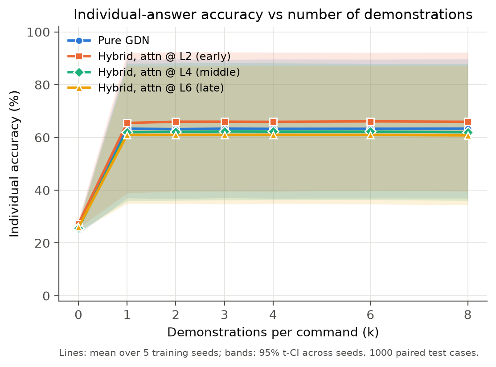

*Figure 2. Individual-prompt accuracy vs k.*

### 5.3 H1: hybrid vs pure

| endpoint | hybrid | diff (pp) | 95% CI, seeds (pp) | 95% CI, hier. bootstrap (pp) | Welch p | Holm p | perm. p | Cohen d | seed-paired p |
|---|---|---|---|---|---|---|---|---|---|
| ICL k=1–8 (primary) | early | +3.5 | [−42.7, +49.7] | [−31.6, +38.3] | 0.866 | 1 | 0.643 | 0.11 | 0.146 |
| | middle | −0.6 | [−45.8, +44.5] | [−35.1, +33.7] | 0.976 | 1 | 0.937 | −0.02 | 0.823 |
| | late | −1.7 | [−46.5, +43.2] | [−36.0, +32.6] | 0.934 | 1 | 0.881 | −0.05 | 0.586 |
| ICL k=1–2 | early | +3.4 | [−42.9, +49.7] | [−31.7, +38.3] | 0.870 | 1 | 0.651 | 0.11 | 0.171 |
| | middle | −0.8 | [−46.0, +44.4] | [−35.4, +33.6] | 0.969 | 1 | 0.937 | −0.03 | |
| | late | −1.7 | [−46.5, +43.1] | [−36.1, +32.4] | 0.932 | 1 | 0.897 | −0.06 | |
| definition | early | +3.7 | [−42.6, +50.0] | [−31.6, +38.8] | 0.860 | 1 | 0.627 | 0.12 | |
| | middle | −0.9 | [−46.2, +44.4] | [−35.8, +33.6] | 0.965 | 1 | 0.937 | −0.03 | |
| | late | −2.1 | [−47.2, +43.1] | [−36.7, +32.5] | 0.919 | 1 | 0.802 | −0.07 | |

**Seed-paired view (secondary).** All architectures share the data stream within a seed, so per-seed differences remove most of the seed effect.

| hybrid | per-seed diff vs pure, seeds 0–4 (pp) | mean [95% CI] | paired t p |
|---|---|---|---|
| early | +4.5, +9.4, +1.4, +4.4, −2.3 | +3.5 [−1.9, +8.8] | 0.146 |
| middle | +1.5, −10.0, −0.8, +0.3, +5.9 | −0.6 [−7.8, +6.6] | 0.823 |
| late | −0.1, −12.2, −1.4, +0.4, +4.9 | −1.7 [−9.5, +6.2] | 0.586 |

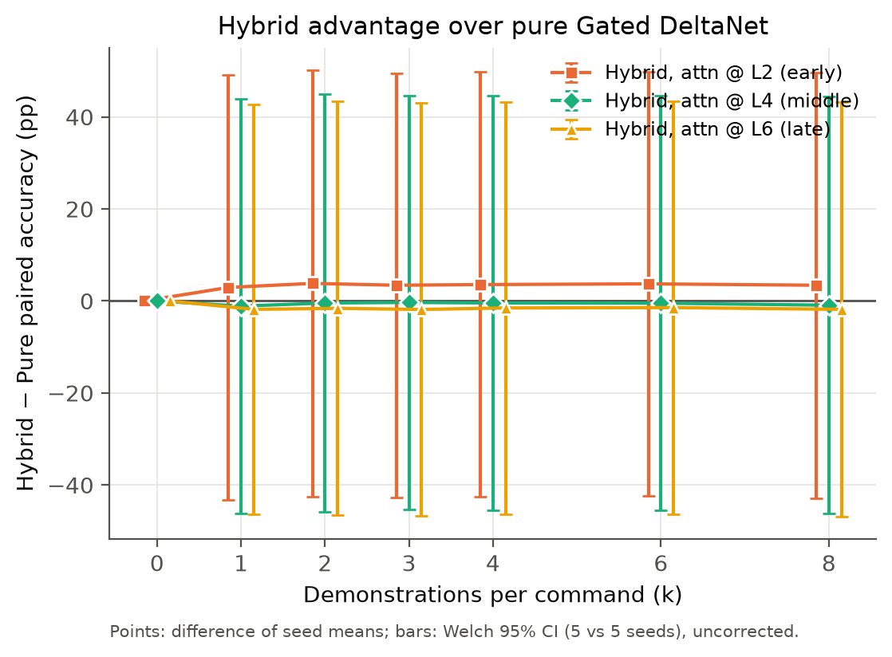

*Figure 3. Hybrid − pure paired accuracy at each k. Bars are Welch 95% CIs over 5 vs 5 seeds, uncorrected and exploratory.*

**H1 is not supported.** No hybrid differs significantly from pure on any endpoint, and the advantage is not larger at small k: the k = 1–2 and k = 1–8 differences are identical.

The early hybrid shows a small positive trend in the seed-paired analysis. It is higher in 4 of 5 seeds, including all three non-take-off seeds (+1.4 to +4.5 pp), but this is not significant.

Per the pre-registration, the non-significant results are *inconclusive*, not evidence of equivalence. The unpaired CIs are about ±45 pp wide.

---

## 6. Attention placement results (H2)

One-way ANOVA across early, middle and late on the primary endpoint gave F = 0.039, p = 0.962. Kruskal–Wallis gave H = 1.86, p = 0.394.

| comparison | diff (pp) | 95% CI (pp) | Welch p | Holm p | perm. p |
|---|---|---|---|---|---|
| early − middle | +4.1 | [−41.4, +49.6] | 0.841 | 1 | 0.675 |
| early − late | +5.2 | [−40.1, +50.4] | 0.799 | 1 | 0.643 |
| middle − late | +1.1 | [−43.1, +45.2] | 0.957 | 1 | 0.730 |

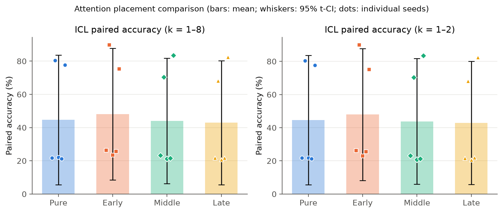

*Figure 4. Primary and small-k endpoints by architecture. Dots are individual seeds; whiskers are 95% t-CIs. The dots form two clusters, at about 21–26% and 68–90%, in every architecture.*

**H2 is not supported.** Descriptively the ordering is early > pure ≈ middle > late, and every difference is small relative to the seed effect.

---

## 7. Control experiment (H3): explicit definitions

| hybrid | hybrid advantage, ICL (pp) | hybrid advantage, definition (pp) | interaction (pp) | 95% CI (pp) | Welch p | Holm p | perm. p |
|---|---|---|---|---|---|---|---|
| early | +3.5 | +3.7 | −0.2 | [−1.0, +0.7] | 0.632 | 1 | 0.627 |
| middle | −0.6 | −0.9 | +0.3 | [−0.6, +1.1] | 0.463 | 1 | 0.444 |
| late | −1.7 | −2.1 | +0.4 | [−0.6, +1.3] | 0.369 | 1 | 0.389 |

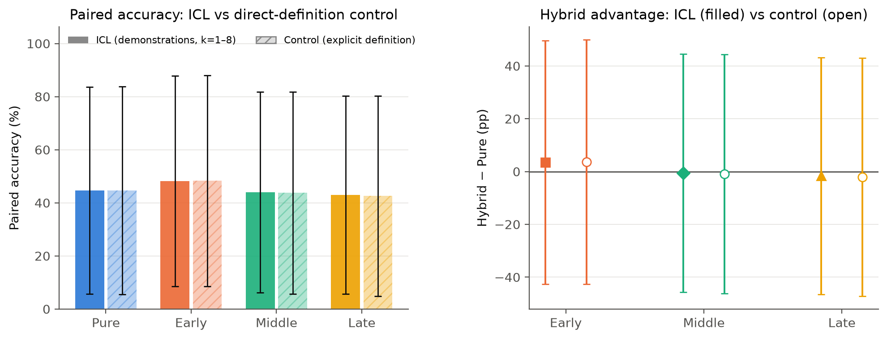

*Figure 6. Left: ICL (k = 1–8) and definition paired accuracy per architecture. Right: hybrid advantage in each condition.*

**H3 is not supported, and the test was largely uninformative.** In every architecture and every seed, ICL paired accuracy equals definition paired accuracy within about 1.4 pp, so there is no ICL-specific difficulty for attention to remove.

The interaction CIs are narrow (±1 pp). They exclude a meaningful differential advantage *for this task*. But that is because identifying the rule from one unambiguous demonstration was trivial for all architectures, not because attention failed to help where inference was hard. The control did not hit a ceiling: definition paired accuracy is 21–90%.

---

## 8. Further analyses

**Training dynamics.**

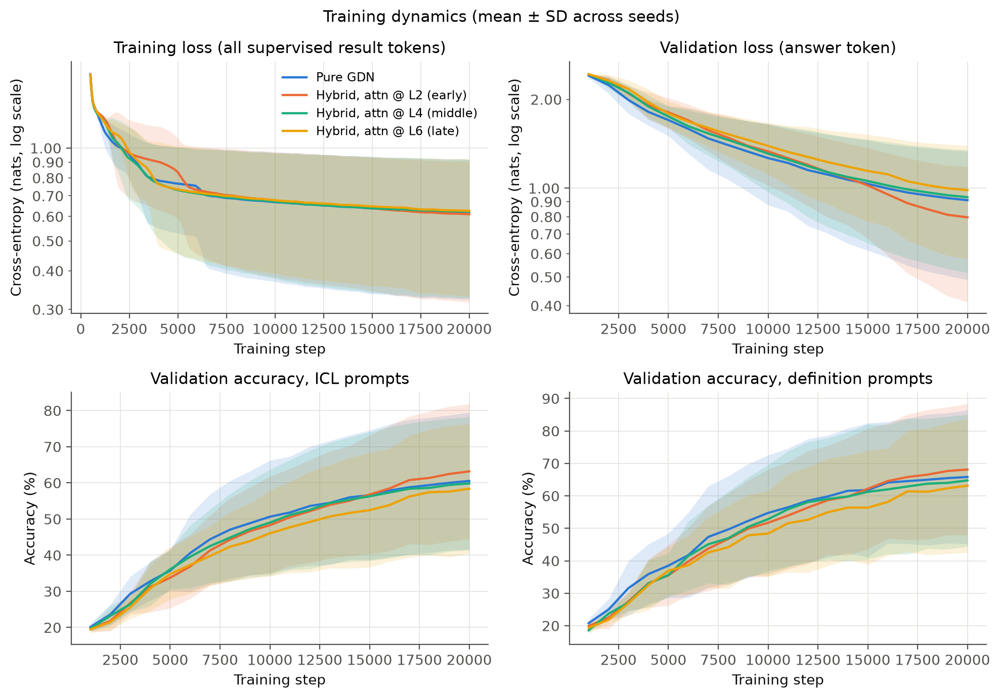

*Figure 5. Training and validation loss and accuracy, as mean ± SD across seeds. The SD bands span both modes of the bimodal outcome.*

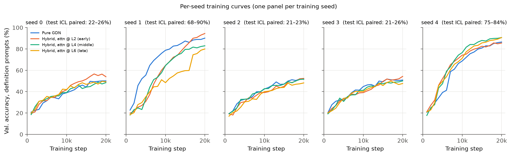

*Figure 8 (added after seeing results). Validation accuracy on definition prompts over training, one panel per seed and one line per architecture. In seeds 1 and 4 all architectures leave the ~50% plateau between about 3k and 8k steps; in seeds 0, 2 and 3 none do within 20k steps.*

Within a seed the architectures differ mainly in *when* they take off, not *whether*. In seed 1, for example, pure took off earliest and hybrid_late latest. This ordering is not consistent across seeds 1 and 4.

**Accuracy by operation.** Individual ICL accuracy (%), k = 1–8, mean ± SD over seeds:

| arch | add | mul | set | sub |
|---|---|---|---|---|
| pure | 60.4 ± 20.6 | 58.1 ± 21.2 | 73.4 ± 22.4 | 61.1 ± 20.8 |
| hybrid_early | 64.8 ± 20.8 | 62.0 ± 22.1 | 72.2 ± 22.6 | 64.4 ± 20.0 |
| hybrid_middle | 58.9 ± 20.0 | 56.1 ± 21.9 | 71.1 ± 22.6 | 62.2 ± 19.8 |
| hybrid_late | 57.1 ± 22.0 | 55.2 ± 21.7 | 72.1 ± 20.5 | 59.2 ± 20.7 |

`set`, which needs no arithmetic, is easiest. `mul` is hardest. This is consistent with modular arithmetic composition being the bottleneck.

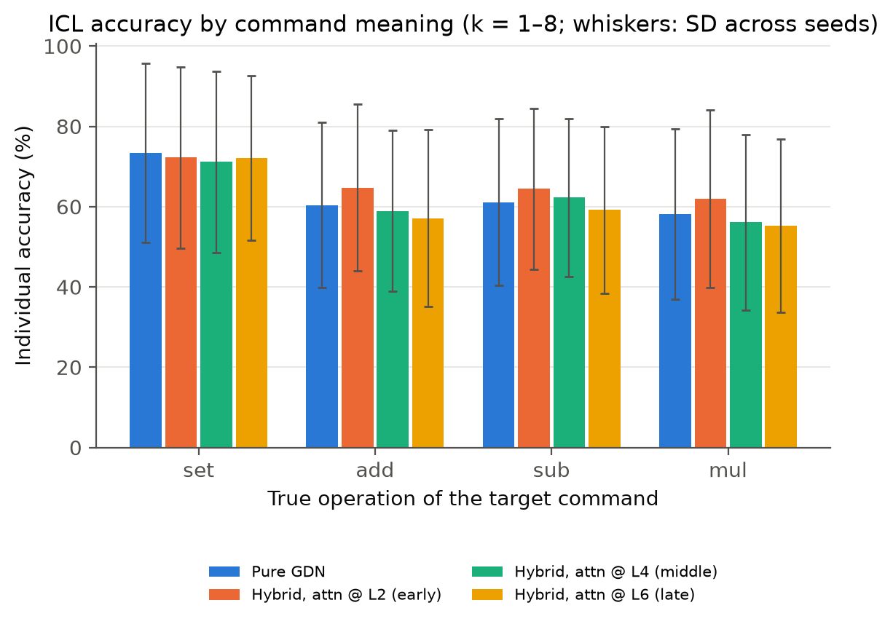

*Figure 7. ICL accuracy by the target's true operation.*

Further tables are in `results/tables/`: per command (`accuracy_by_command.md`), per seed (`accuracy_by_seed.csv`), and per run, condition and k (`per_run_condition_k.csv`).

---

## 9. Statistical analysis: power and interpretation

- **Unpaired design.** With n = 5 per arm, an unpaired two-sided t-test has 80% power only for |d| ≥ 2.03. With the observed between-seed SD of 31 pp, that corresponds to a difference of roughly **63 pp**. The pre-registered unpaired tests therefore had essentially no power against realistic effects; the bimodality makes the between-seed SD very large.
- **Seed-paired design.** A paired t-test has 80% power for d_z ≥ 1.69. With the observed SD of per-seed differences (4.3–6.3 pp), that corresponds to about **7–11 pp**. Effects of that size or larger are not supported by the seed-paired data: every observed mean difference is 3.5 pp or less in absolute value, and every p-value is 0.15 or higher. Smaller effects, of a few pp, cannot be excluded.
- **Hierarchical bootstrap.** Resampling seeds and then test cases gives CIs similar to the seed-level t-CIs. Test-case sampling noise (1000 pairs, SE ≈ 1.3–1.6 pp per model) is negligible compared with seed variance.
- **Multiple comparisons.** Holm correction did not change any conclusion; every uncorrected p-value was already > 0.14.

---

## 10. Exploratory follow-up (post hoc): data order vs initialisation

**Question.** In the main design a seed fixes both the initialisation and the training-data order. Which one drives the all-or-nothing take-off?

**Design** (decided after seeing the main results, and not pre-registered):
- pure GDN only;
- data-stream seed ∈ {0, which failed in all 4 main architectures; 1, which succeeded in all 4};
- initialisation seed ∈ {10, 11, 12};
- 20k steps, otherwise identical to the main configuration;
- validation set only (`configs/seedsplit_jobs.json`, `checkpoints/seedsplit/`).

The reading rule was stated before the runs: if take-off (final validation definition accuracy > 70%) tracks the data seed, the data order is decisive.

| init seed | data stream 0 | data stream 1 |
|---|---|---|
| 10 | 50% (plateau) | 49% (plateau) |
| 11 | 50% (plateau) | **87% (take-off)** |
| 12 | **83% (take-off)** | 53% (plateau) |

*Final validation accuracy on definition prompts. Final validation ICL accuracy is 47 / 46 / 49 / 79 / 77 / 48% in the same order.*

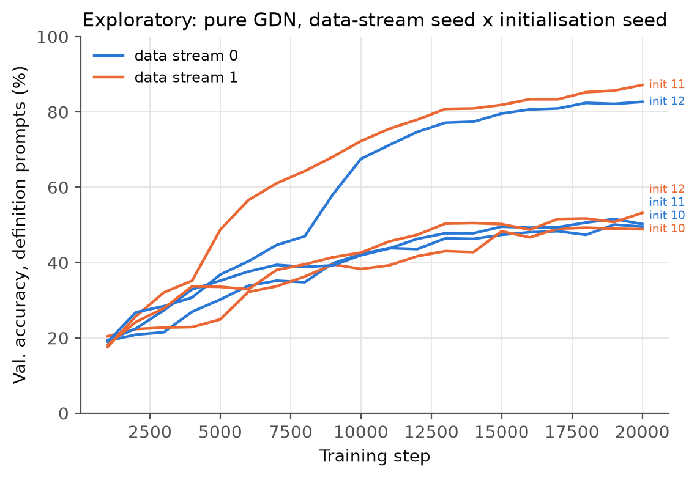

*Figure 9. Validation accuracy over training for the 6 follow-up runs. Colour shows the data stream; labels show the initialisation seed.*

**Result: take-off does not track the data stream.** One of three initialisations took off on each stream. The data stream that succeeded in all 20 main runs (stream 1) failed with 2 of 3 new initialisations, and the stream that failed everywhere (stream 0) succeeded with init 12. Across all 26 pure-or-hybrid runs, the take-off rate is about 35–40%.

**What, then, is shared within a main-experiment seed?** We checked by constructing all four architectures with the same seed:
- Because the attention layer changes the order of random draws, **99.8% of the initial parameters differ** between architectures with the same seed. This includes the embeddings, all projections, the MLPs and the output head.
- What *is* identical across all four architectures within a seed:
  - the data stream;
  - constant norm weights;
  - the GDN **decay parameters (`A_log`, `dt_bias`) and short-convolution weights of layers 0 and 1**, which precede every attention placement.

**How unlikely the main-experiment pattern is by chance.** Suppose take-off were independent across runs with p ≈ 0.4. The chance that all four architectures agree in each of 5 seeds would then be about (0.4⁴ + 0.6⁴)⁵ ≈ 10⁻⁴.

**Hypothesis after this follow-up.** Data order alone is not sufficient. The most plausible candidate was the initialisation of the first two GDN layers' decay and convolution parameters, which are identical across architectures within a seed. Experiment A (§10.1) tested it.

### 10.1 Exploratory experiment A (post hoc): does the early-layer initialisation decide take-off?

**Design** (fixed, with its prediction, in `EXPERIMENT_LOG.md` before the runs):
- pure GDN, data stream 1, 20k steps, validation only (`configs/earlyinit_jobs.json`, `checkpoints/earlyinit/`);
- `--early-init-seed S` replaces `A_log`, `dt_bias` and the q/k/v short-convolution weights of GDN layers 0–1 with those of seed S's initialisation, leaving every other parameter (the "body") at the `--seed` initialisation (tested by `test_early_init_transplant`);
- four transplants, plus reruns of two §10 runs to measure run-to-run non-determinism.

**Prediction if the early layers are decisive:** both early-11 transplants take off, and body 11 with early 10 or 12 plateaus.

| body seed | early-layer seed | definition (%) | ICL (%) | take-off? |
|---|---|---|---|---|
| 10 | 11 | 89.4 | 82.0 | yes |
| 12 | 11 | 47.9 | 46.3 | no |
| 11 | 10 | 80.1 | 72.2 | yes |
| 11 | 12 | 96.8 | 89.9 | yes |
| 11 | 11 (rerun of §10) | 87.1 | 79.3 | yes (§10: 87.1 / 79.3) |
| 10 | 10 (rerun of §10) | 50.1 | 45.4 | no (§10: 48.8 / 45.6) |

*Final validation accuracy at 20k steps.*

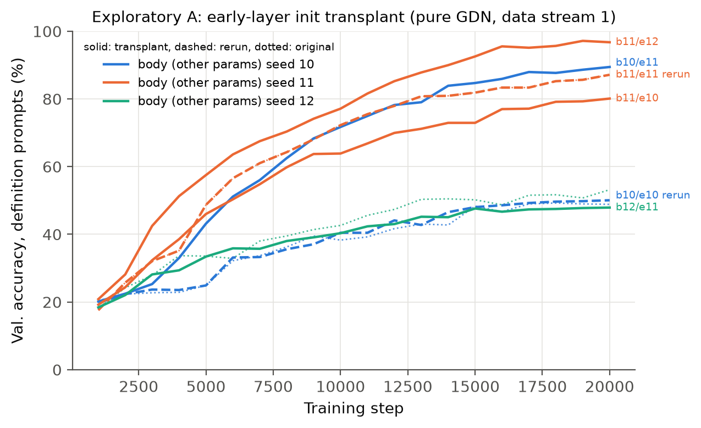

*Figure 10. Validation accuracy on definition prompts. Colour: body seed. Solid: transplant. Dashed: rerun. Dotted: the §10 original.*

**Result: the prediction failed, so the early-layer initialisation does not explain the seed effect.**
- Body 11 took off with foreign early tensors (from both 10 and 12), contrary to the prediction.
- Early 11 rescued body 10 but not body 12.
- The reruns reproduced their originals almost exactly (identical to three digits for (11, 11)). Take-off is therefore deterministic given the initialisation and data. Kernel non-determinism does not flip it.

**Interpretation.** Take-off is a sensitive function of the whole initialisation. Replacing six small tensors (well under 1% of the parameters) can flip the outcome (body 10), but it does not always do so (bodies 11 and 12). A simple "lucky early layers" story is ruled out. This makes the agreement of all four architectures within each main-experiment seed (§10, probability ≈ 10⁻⁴ under independence) harder to explain, because 99.8% of their initial parameters differ. It remains an open observation. With only five main seeds, a coincidence cannot be fully excluded either.

---

## 11. Experiment 2 (pre-registered): ambiguous demonstrations

**Why.** In Experiment 1 one demonstration identified a meaning, so rule inference was never the bottleneck (§5–§7). Experiment 2 makes inference necessary and changes nothing else. It was pre-registered in `IMPLEMENTATION_PLAN.md` §9 before any run, including a switch of the primary test to the seed-paired comparison.

**Task change.** Every demonstration is consistent with **exactly two** operations: the true one and a confuser drawn uniformly from the other three. One demonstration never identifies the meaning. k demonstrations do unless they all share the confuser, so the identifiable fraction of test prompts is 0 / 0.67 / 0.89 / 0.96 / 0.99 / 1.00 at k = 1 / 2 / 3 / 4 / 6 / 8 (measured on the test set with the interpreter). Programs, models, optimiser, 20k steps and seeds 0–4 are unchanged. Data: `data/amb/`; runs: `checkpoints/amb/`; predictions: `results/raw_amb/`; tables: `results/amb/tables/`; figures: `results/amb/figures/`.

**Execution note.** All 20 runs completed. Eight runs froze mid-training for ~18 h. All processes stalled at the same moment because the user's shared memory limit on the lab server was throttled by the combined load of these jobs and other concurrent jobs (diagnosed later; `EXPERIMENT_LOG.md` Phase 8 incident). They were resumed from their step-8000 checkpoints after a resume bug was fixed (`EXPERIMENT_LOG.md`). Resumption restores weights, optimiser, RNG and data position, so these runs differ from uninterrupted ones only by kernel non-determinism.

### 11.1 Results

| arch | ICL paired, k=1–8 (primary) | ICL paired, k=1–2 | definition paired | ICL − definition | take-offs |
|---|---|---|---|---|---|
| pure | 25.3 [−2.2, 52.8] | 16.3 [1.3, 31.3] | 34.1 [−0.5, 68.6] | −8.8 | 1/5 |
| hybrid_early | 15.9 [14.5, 17.3] | 11.2 [10.2, 12.3] | 22.2 [19.4, 24.9] | −6.3 | 0/5 |
| hybrid_middle | 33.3 [3.6, 63.0] | 20.7 [5.2, 36.3] | 43.1 [6.8, 79.4] | −9.8 | 2/5 |
| hybrid_late | 34.9 [0.6, 69.2] | 21.5 [2.1, 40.9] | 45.0 [2.2, 87.8] | −10.1 | 2/5 |

*Mean [95% t-CI over 5 seeds], %. Take-off: final test definition individual accuracy > 70%.*

Per-seed primary endpoint (ICL paired, k = 1–8, %):

| seed | pure | early | middle | late |
|---|---|---|---|---|
| 0 | 14.6 | 15.0 | **46.7** | 14.1 |
| 1 | 16.1 | 16.5 | **69.3** | **60.2** |
| 2 | 16.1 | 14.4 | 17.3 | 15.8 |
| 3 | 14.8 | 16.4 | 17.8 | 14.7 |
| 4 | **65.0** | 17.2 | 15.6 | **69.7** |

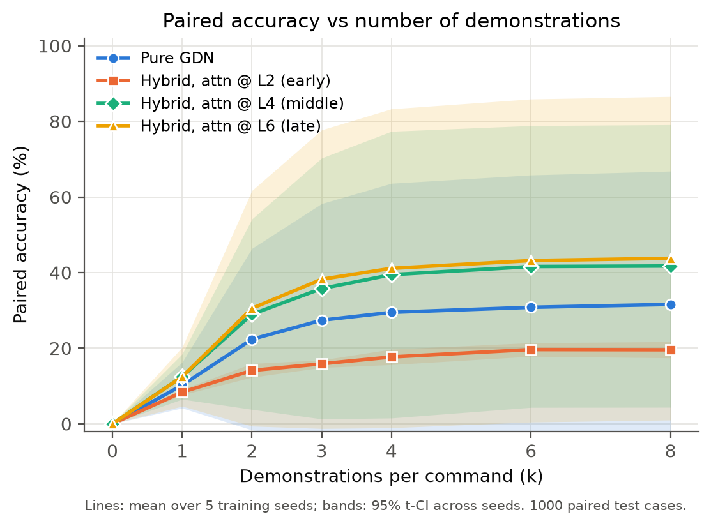

*Figure 11. Experiment 2: paired accuracy vs k (mean over 5 seeds, 95% t-CI bands). Unlike Experiment 1, accuracy now rises from k = 1 to k ≈ 4.*

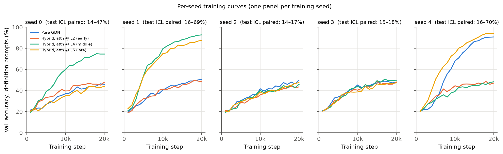

*Figure 12. Experiment 2: validation accuracy on definition prompts during training, one panel per seed. Take-off is no longer shared across architectures within a seed.*

**Pre-registered tests** (seed-paired t-test, Holm over 3 hybrids; `results/amb/tables/exp2_paired.md`):

| test | early − pure | middle − pure | late − pure |
|---|---|---|---|
| H1, ICL k=1–8 (primary) | −9.4 pp [−36.1, +17.2], Holm p = 1.0 | +8.0 [−40.0, +56.1], p = 1.0 | +9.6 [−14.6, +33.7], p = 1.0 |
| H1, ICL k=1–2 | −5.0 [−19.5, +9.4], p = 1.0 | +4.4 [−21.6, +30.5], p = 1.0 | +5.2 [−9.2, +19.6], p = 1.0 |
| H3, (ICL − def) interaction | +2.5 [−4.5, +9.4], p = 1.0 | −1.0 [−12.8, +10.8], p = 1.0 | −1.4 [−7.0, +4.3], p = 1.0 |

*Unadjusted paired-t p-values for H1 primary are 0.38 / 0.67 / 0.33. Sign-flip p ≥ 0.44 throughout. The secondary unpaired tests (Welch, permutation, bootstrap) are also all non-significant (`h1_comparisons.md`).*

- **H2:** Friedman χ² = 2.8, p = 0.25. Pairwise Holm p ≥ 0.53.
- **Decision under the pre-registered rule (Holm-corrected paired t at α = 0.05): H1, H2 and H3 are not supported in Experiment 2 either.**

### 11.2 What changed relative to Experiment 1

1. **Inference is now exercised.** In every architecture, accuracy rises with k and saturates at k ≈ 4, tracking identifiability. ICL stays below the definition control: −6 to −10 pp on the primary endpoint, driven by k = 1–2.
2. **The architecture comparison is still decided by take-off, not by inference ability.** The mean differences (middle and late ahead by ~9 pp, early behind by ~9 pp) come entirely from which runs took off (pure 1, early 0, middle 2, late 2). Within a regime the architectures look alike:
   - non-take-off runs: ICL paired 14–18% for all four;
   - take-off runs: 47–70%.
   The H3 interaction is near zero, so no architecture uses the demonstrations better than it uses the stated definition.
3. **Within-seed agreement disappeared** (exploratory). All four architectures agreed on take-off in only 2 of 5 seeds (seeds 2 and 3, both plateau). That is what independence at the observed 25% take-off rate predicts (expected 1.6 of 5). This weakens the "shared seed cause" reading of Experiment 1 (§10). Its 5/5 agreement may have been partly coincidence, or tied to that specific task's data. Seeds 1 and 4, the take-off seeds in Experiment 1, again account for 4 of the 5 take-offs, so some seed effect may remain.

### 11.3 Exploratory: how well do models that learned the task combine ambiguous demonstrations?

(`results/amb/tables/exp2_runs.md`, `exp2_identifiability.md`; post hoc.)
- In all 5 take-off runs (pure, middle, late), accuracy on prompts whose demonstrations *identify* the meaning matches definition accuracy (86.1% vs 86.8% on average). They combine individually ambiguous demonstrations essentially perfectly.
- At k = 1, where two operations remain possible, their accuracy is 1.01–1.19 × half their definition accuracy. That is about what choosing one of the two consistent operations would give (slightly more, because the two operations sometimes produce the same answer).
- The pure GDN run that took off (seed 4) is as close to this ideal as the hybrids (ratio 1.01 vs 1.02–1.19).
- So, at this scale, a pure Gated DeltaNet that learns the task performs the required multi-demonstration inference as well as the hybrids. What differs between runs is only *whether* the program-execution skill is learned within 20k steps. (For plateau runs the ratio is ~1.5, which only says they guess non-uniformly; it is not interpretable as inference.)

---

## 12. Discussion

**What the experiments show.** In this setting, ~7M-parameter models trained for 20k steps on a modular-arithmetic program-execution task, replacing one of eight GDN layers with softmax attention neither helped nor hurt measurably. This held at all three depths, whether meanings had to be inferred from demonstrations or were given explicitly. It also held both when one demonstration sufficed (Experiment 1) and when several individually ambiguous demonstrations had to be combined (Experiment 2).

**Why the hypotheses were not really tested.** The proposal's hypotheses concern *rule inference from demonstrations*. Here rule inference was saturated at k = 1 for every architecture: a single demonstration whose result is consistent with only one operation suffices. Once the operation is identified, the remaining difficulty is executing a short program with modular arithmetic. Both architectures share that difficulty, and it shows up identically in the definition control.

A pure GDN can evidently bind a command to an operation from one demonstration as well as a hybrid can. The interesting regime for H1 and H3 would be one where inference is genuinely hard, for example:
- individually *ambiguous* demonstrations that must be combined (k > 1 genuinely needed);
- many simultaneous commands (associative-recall load);
- long distances between demonstrations and query.

The task as calibrated did not reach that regime. The calibration fixed difficulty through the *execution* parameters (inits and updates) so that the pure model could learn at all. In hindsight this kept the inference component easy.

Experiment 2 (§11) addressed the first of these variants, and inference then became necessary: accuracy rose with k up to k ≈ 4. It still did not separate the architectures. Every model that learned the execution skill, pure GDN included, combined the ambiguous demonstrations close to optimally (§11.3). At this scale and task the binding of command to operation, even from ambiguous evidence, is not where a single attention layer helps. The remaining candidates (many simultaneous commands, long distances) are untested.

**The seed lottery.** The largest source of variance was a seed-level, all-or-nothing transition. Seeds either crossed into a high-accuracy regime early in training (3k–8k steps) or stayed on a slowly rising plateau. In Experiment 1 this happened identically across architectures sharing a seed, which suggested a seed-level cause shared by all architectures. §10 shows it is not the data order alone, and §10.1 shows it is not the shared early-layer decay and convolution initialisation either: take-off is a sensitive, but deterministic, function of the whole initialisation. In Experiment 2 the within-seed agreement was no higher than independence predicts (§11.2). The Experiment-1 pattern may therefore have been partly coincidental or task-specific. Take-off itself remained the dominant source of variance (5/20 runs).

Phase-transition-like learning of algorithmic tasks is well documented. Its practical consequence here is that architecture comparisons at a fixed, non-converged budget need many seeds, or paired designs, or training to convergence.

**The early-attention trend.** hybrid_early was the best architecture descriptively. It was higher than pure in 4 of 5 seeds, and all of its non-take-off seeds are slightly above the other architectures' plateaus (23–26% vs 21–23%). This was a weak, non-significant signal (p = 0.15) and not a finding. Experiment 2 did not replicate it: hybrid_early was the only architecture with no take-off (0/5) and was descriptively the worst.

## 13. Limitations

1. **Non-converged training.** All validation curves were still rising at 20k steps. Results describe a fixed compute budget, not asymptotic capability.
2. **Rule inference was trivial in Experiment 1 (k = 1 suffices).** Experiment 2 made it non-trivial, but only through ambiguity. Load (many commands) and distance were not varied.
3. **Five seeds plus a bimodal outcome.** Unpaired tests are powerless (MDE ≈ 63 pp). Even seed-paired tests only exclude effects of roughly ≥ 7–11 pp.
4. **The cause of the take-off lottery is unresolved.** §10 rules out data order alone and §10.1 rules out the shared early-layer initialisation as a sufficient cause (12 runs, pure model only). Because take-off decides the outcome, any architecture effect on *learning speed of execution* would show up as a take-off-rate difference. Detecting a rate difference like 1/5 vs 2/5 would need far more seeds.
5. **A single model scale and configuration** (d = 256, 8 layers), one attention-layer count (exactly one) and one GDN configuration.
6. **Task deviations.** Program complexity was reduced from the original 3 inits + 4 updates to 2 + 3, chosen by a pre-stated calibration rule on the pure model only. The 70% calibration target was not reached.
7. **Small parameter mismatch.** Hybrids have 1.0% fewer parameters.
8. **Non-deterministic kernels.** `fla` Triton kernels are not bit-deterministic, so retraining is not bit-for-bit. In practice two reruns (§10.1) reproduced their originals' final accuracy to within 1.3 pp, with the same take-off outcome. Evaluation from a checkpoint is deterministic (tested).

## 14. Conclusion

We found **no evidence**, in two pre-registered experiments, that a single causal attention layer improves a Gated DeltaNet's ability to learn command meanings from demonstrations, at any of the three placements. We also found no evidence that its effect differs between inferred and stated meanings.

In Experiment 1 rule inference was easy (one demonstration sufficed). In Experiment 2 demonstrations were individually ambiguous, and models that learned the task, including the pure GDN, combined them close to optimally. In both experiments the variance was dominated by an all-or-nothing transition in learning to *execute* programs, which occurred in 5–8 of 20 runs. That transition, not demonstration use, decided the architecture comparisons. Five seeds cannot resolve differences in its rate.

The results are therefore inconclusive about small effects, and they argue against a large inference advantage from one attention layer at this scale. A more decisive test would need many more seeds, or training to convergence, and inference loads such as many simultaneous commands or long distances. The paired-case framework, interpreter and GPU-cap-aware pipeline in this repository can be reused for it.

### Which experiments were completed

| experiment | status |
|---|---|
| Test suite (50 tests: interpreter, generator incl. ambiguous demos, leakage, pairing, model structure and causality, early-init transplant, checkpoint resume, metrics, determinism) | completed, all 50 pass on GPU |
| Pilot v1 (3×4 task) | stopped at ~5k steps (floor effect); archived |
| Calibration rounds 1 and 2 (pure only, validation only) | completed |
| Main: 4 architectures × 5 seeds × 20k steps, evaluated on 1000 paired test cases × 8 conditions | **completed (20/20)** |
| Pre-registered analysis (H1, H2, H3; Welch, permutation, Holm, Cohen's d, hierarchical bootstrap, seed-paired) | completed |
| Exploratory data-vs-init follow-up (pure, 6 runs, validation only) | completed (§10) |
| Exploratory experiment A: early-layer init transplant (pure, 6 runs, validation only) | completed (§10.1) |
| Experiment 2 (pre-registered): ambiguous demonstrations, 4 architectures × 5 seeds, full evaluation and analysis | **completed (20/20)** (§11); 8 runs resumed from step 8000 after a freeze |
| Mod-13 load-scaling pilot (pre-registered, `IMPLEMENTATION_PLAN.md` §11), N = 4–128 bound commands | **failed the learnability check** (§16) |
| Compact MQAR validation study (pre-registered, `IMPLEMENTATION_PLAN.md` §13) | **stopped at the transformer gate** (§16) |
| Longer training to convergence; more seeds; distance task variants | **not done** (compute and time) |

## 15. Reproducibility

```bash
uv venv .venv --python 3.11
uv pip install --python .venv/bin/python -r requirements.txt        # exact: requirements.lock.txt
export OPENBLAS_NUM_THREADS=1
.venv/bin/python -m pytest -q tests                                   # CUDA tests need a GPU
.venv/bin/python scripts/generate_data.py --config configs/base.yaml  # hashes: data/data_manifest.json
.venv/bin/python scripts/pregenerate_train.py --config configs/base.yaml --seeds 0 1 2 3 4   # optional
.venv/bin/python scripts/run_experiments.py --config configs/base.yaml --group main
.venv/bin/python scripts/analyze_results.py
.venv/bin/python scripts/generate_figures.py
# exploratory follow-ups (§10, §10.1)
.venv/bin/python scripts/run_experiments.py --jobs-json configs/seedsplit_jobs.json --jobs-per-gpu 3
.venv/bin/python scripts/run_experiments.py --jobs-json configs/earlyinit_jobs.json --jobs-per-gpu 3
# Experiment 2 (§11)
.venv/bin/python scripts/generate_data.py --config configs/ambiguous.yaml  # hashes: data/amb/data_manifest.json
.venv/bin/python scripts/run_experiments.py --config configs/ambiguous.yaml --group amb
.venv/bin/python scripts/analyze_exp2.py
.venv/bin/python scripts/generate_figures.py --tables results/amb/tables --ckpt-dir checkpoints/amb --out results/amb/figures
```

Every reported number is traceable as follows:
- `results/raw/<arch>_s<seed>.csv` holds one row per test prompt (prediction, correctness, k, condition, case id).
- `results/tables/` and `results/stats.json` are produced from those files by `scripts/analyze_results.py`.
- Training logs are in `checkpoints/main/<run>/train_log.jsonl`; configurations and environment are in `metadata.json`.
- Experiment 2: `results/raw_amb/` → `results/amb/tables/`, `results/amb/stats.json`, `results/amb/stats_exp2.json` (`scripts/analyze_exp2.py`).

Software: Python 3.11, torch 2.7.1+cu126, triton 3.3.1, flash-linear-attention 0.6.0.

## 16. Associative recall under binding load

Does a single attention layer help a small Gated DeltaNet retrieve values when a prompt contains many bindings?
The follow-up tests recall directly with a transformer positive control and a smaller recurrent key state.

### 16.1 Why the mod-13 pilot failed

The first load-scaling task asked the model to retrieve a command's offset `c` and predict `(x + c) mod 13`.
Both `pure_s0` and `hybrid_early_s0` stayed at approximately `ln(13) = 2.5649` training answer loss from about step 1,000 through step 12,400, where their gradient norms were 0.136 and 0.142.
Validation averaged 6.61% with demonstrations in both runs and 7.11–7.22% with explicit definitions, near the 7.69% chance rate.

With independent uniform operands, the answer is independent of either operand on its own.
Learning to retrieve the offset alone or learning addition without the offset gives no expected loss reduction.
This modular sparse-parity structure explains why providing the offset explicitly as a binding did not help the models get started.
The two runs failed under §11 rule 1 and provide no evidence about state capacity.
The archived traces contain train and validation metrics through step 12,400 and no terminal test score.

### 16.2 Multi-query associative recall

Each prompt binds `N` distinct keys sampled from 512 made-up commands to independent values from a 64-token vocabulary.
It starts with `<bos>`, lists the bindings as `M k v ;`, and then asks distinct queries as `Q k -> v ;` in random order.
The answer is the stored value.
Training samples `N` uniformly from 4, 8, 16, 32, 64, 128 and 256.
There are four queries at `N = 4` and eight otherwise, with cross-entropy supervision only on query answers.
Accuracy is measured over individual queries, with chance at 1.5625%.
The fixed validation and test sets have 100 and 250 prompts per load, respectively, and record the position of each queried binding.

The established pure GDN and three one-attention-layer hybrids use eight layers of width 256.
The positive control uses the same causal attention with RoPE in all eight mixers.
The smaller state uses 32-dimensional GDN query/key heads, holding GDN value and attention head widths at 64.

| Architecture | Parameters at GDN key width 64 | Parameters at GDN key width 32 |
|---|---:|---:|
| Transformer | 6,733,056 | |
| Pure GDN | 7,298,880 | 6,766,400 |
| Early hybrid | 7,228,152 | |
| Middle hybrid | 7,228,152 | 6,762,232 |
| Late hybrid | 7,228,152 | |

The design and ordered decision rules were pre-registered in `IMPLEMENTATION_PLAN.md` §12.
The 400-step sizing run measured 0.196 seconds per step on one L40, putting the original 14-run plan at roughly 15–20 hours.
The user stopped the original transformer gate while its last logged step was 100, before any validation measurement.
The original two-seed pilot and its R1–R6 decision rules were never reached.

### 16.3 Compact validation study

The replacement study (§13) used four layers at width 128 with four 32-dimensional heads per mixer.
It compared a transformer, pure GDN and a hybrid with attention in layer 2 (zero-based).
Each arm used seed 0, batch 64 and 1,500 steps, with a 300-step warmup and the base optimizer settings.
The transformer gate required 90% validation accuracy at `N = 16` and the pure gate required 90% at `N = 8`.
The study used the fixed validation set throughout.
The fixed test set stayed off the training host.

**The transformer gate failed.**
The step-1,000 training answer loss was 3.270, outside the chance-loss abort interval around `ln(64) = 4.159`.
At step 1,500, the transformer (1,006,208 parameters) reached 11.25% at `N = 16`, below the 90% requirement.
The pure and middle-hybrid seed-0 runs were skipped under the pre-registered stopping rule.

| N | 4 | 8 | 16 | 32 | 64 | 128 | 256 |
|---|---:|---:|---:|---:|---:|---:|---:|
| Transformer validation accuracy (%) | 28.50 | 17.00 | 11.25 | 8.13 | 6.13 | 4.38 | 2.25 |

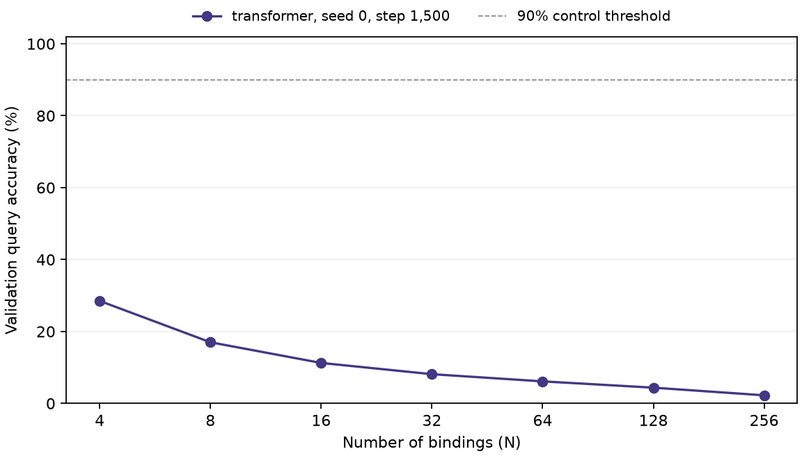

The compact middle hybrid reached 97.75% at `N = 16` in the 400-step sizing run with seed 99.
That shows at least one model learned the low-load task in this pipeline.
The sizing trace used a different seed, schedule and stopping point, so it is descriptive and cannot establish an architecture effect.
The failed positive control and the single-seed validation design leave recurrent capacity and attention placement unresolved.
One next experiment is a compact transformer-only curriculum that starts with `N = 4–16` and expands the training loads once the transformer clears the same fixed `N = 16` validation gate.

Reproduce the compact curve and table from the recorded validation logs with `python scripts/analyze_mqar.py --validation-dir checkpoints/mqar_compact --out results/mqar_compact`.

### References

These are cited as in the proposal:
- Garg et al. (2022)
- Olsson et al. (2022)
- Akyürek et al. (2022)
- Chan et al. (2022)
- Arora et al. (2024)
- Yang et al. (2025), *Gated Delta Networks*
- Wang et al. (2025)
- Daniels et al. (2025)
